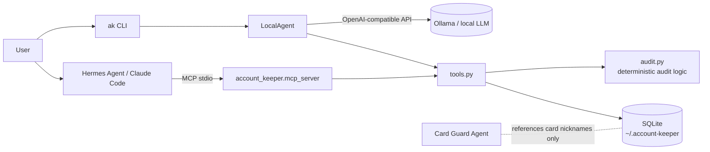

# Account Keeper Agent 🗝️

English | [日本語](README.ja.md)

> **Status: Mock / Planned** — a mock that shows the concept in working form.

An agent that keeps track, locally, of *which web services you signed up for with which email, phone, address and 2FA*, and helps you with
**moving house, changing your email address or phone number, and cleaning up abandoned accounts**.

- 🏠 **Local-first** — data lives only in a local SQLite file. Inference runs on a local LLM (Ollama)
- 🔌 **MCP server** — callable from any MCP client, e.g. Hermes Agent / Claude Code
- 🙅 **No passwords** — passwords belong to your password manager, cards to [Card Guard Agent](#related-products).
  Fields such as `password` / `card_number` are rejected on save

## What it can do (mock version)

| Tool | Description |
|---|---|
| `audit_2fa` | Lists accounts with no 2FA / SMS-only / email-only, prioritizing finance, government and work services |
| `find_dormant` | Retirement candidates, dormant judged in calendar months (default 12). No days approximation of months*30; months must be >= 1 (values <= 0 are rejected). Flagged if a card registration remains |
| `retire_plan` | Retirement candidates, dormant judged in calendar months, sorted money-first (household accounts / payments / games). Accounts with unknown last-used date (e.g. just imported from Bitwarden) are separated as "needs review" instead of mixed into candidates. Money hints are matched at word beginnings; display / repair are not counted as payments |
| `retire_procedure` | Cancellation & unlinking steps for one service (bank side → in-service → cancel → confirm data deletion). The 4 steps are a generic form; confirming each service's official help page for its actual cancellation process is built in as mandatory |
| `plan_change` | When changing email, phone, address label or card nickname: the services that need updating, ordered by importance. Also warns about the SMS 2FA trap |
| `email_exposure` | Number of linked services per email address (blast radius if leaked). Case differences are merged as the same address |
| `list_accounts` / `search_accounts` / `upsert_account` | Read / update registration records |

> 🔒 **The owner performs cancellations and unlinking** — the agent never logs in. `retire` only produces a plan of *what to unlink and in which order*. From Bitwarden it uses item names and URLs only; the password column is never read.

## Quick start

No dependencies (Python 3.10+ standard library only).

```bash
git clone https://github.com/johnknash2025/account-keeper-agent
cd account-keeper-agent
python -m account_keeper demo        # load 12 fictional sample accounts
python -m account_keeper audit       # run a combined audit
python -m account_keeper change phone 090-0000-0001   # impact scope of a phone-number change
python -m account_keeper retire --email taro.main@example.com   # cancellation & unlinking plan (owner executes it)
```

```text
■ Weak 2FA
  [high  ] CloudConsole           email  → switch to a passkey or TOTP
  [high  ] MyBank Online          sms    → switch to a passkey or TOTP
  [medium] FurimaPlus             none   → enable 2FA
■ Dormant accounts (12+ months)
  PhotoShare             1052 days → consider retiring
  FurimaPlus             959 days  → retire or unlink the registered card
```

Import a CSV the owner exported from Bitwarden containing "item names and URLs only" (the password column is not read):

```bash
python -m account_keeper import-bitwarden data/sample_bitwarden.csv   # report rows read and Store records separately
python -m account_keeper retire --out retire-plan.md                  # --months must be >= 1 (values <= 0 are rejected)
```

```text
## Sweep (work top-down)
1. FurimaPlus   (shopping / 970 days unused) — money link: card registration
2. VideoSub     (other    / 661 days unused) — money link: card registration
3. PhotoShare   (sns      / 1063 days unused) — money link: none
■ FurimaPlus: STEP1 bank/card-side unlink → STEP2 in-service removal → STEP3 cancel → STEP4 confirm personal-data deletion
```

## Local LLM agent (Ollama)

```bash
ollama pull qwen3:8b
export ACCOUNT_KEEPER_MODEL=qwen3:8b      # any tool-calling-capable model
python -m account_keeper ask -v "I want to change my phone number — what should I handle first?"

# to check the behaviour without an LLM
python -m account_keeper ask --offline "Any accounts I've been leaving alone?"
```

Any OpenAI-compatible API works (`ACCOUNT_KEEPER_LLM_URL`, default `http://localhost:11434/v1`).
Since registration data is never sent to the cloud, local inference is the default.

## Use from Hermes Agent / Claude Code (MCP)

```bash
python -m account_keeper.mcp_server   # started over stdio (a minimal, dependency-free implementation)
```

- Hermes Agent: [`examples/hermes-config.yaml`](examples/hermes-config.yaml)
- Claude Code: [`examples/claude-code.mcp.json`](examples/claude-code.mcp.json)

Typical usage: a parent agent (Hermes etc.) calls `plan_change(field="address_label", old_value="旧住所")` as a subtask of a "moving task".

## Architecture



Audit logic lives in deterministic code (`audit.py`) that does not depend on an LLM; the LLM is only responsible for "which tool to call" and for explaining and prioritizing the results.

## Data model

| Field | Example | Notes |
|---|---|---|
| `service` | MegaMart | primary key |
| `category` | shopping / sns / finance / gov / work / other | used for importance ranking |
| `email`, `phone`, `login_id` | | |
| `address_label` | Home / Old address / Farm storage shed | **a label, not the address itself** |
| `two_factor` | none / sms / email / totp / passkey | |
| `payment_ref` | Main card | card **nickname** on the Card Guard side only |
| `url` | furima.example.jp | added by Bitwarden import (also used to judge ties to money) |
| `last_used` | 2026-10-10 | |

## Roadmap

- [ ] DB encryption (SQLCipher or age)
- [ ] Auto-registration by picking up "signup complete" emails from the inbox (processed locally)
- [ ] Cross-checking against leaked data (integration with [leakwatch-jp](https://github.com/johnknash2025/leakwatch-jp))
- [x] Dormant-account sweep (money-first) plus a cancellation & unlinking plan (`retire` / uses Bitwarden URLs only)
- [ ] Automatic guidance to cancellation-page URLs / browser-operating agent integration
- [ ] Integration with Card Guard Agent (finding what to update when a card is reissued)

## Related products

- **Card Guard Agent** (Planned) — card-management agent. Financial information is deliberately kept separate from this project.

## License

GNU Affero General Public License v3.0 or later (AGPL-3.0-or-later). Versions published under MIT before 2026-10-31 remain under MIT.
