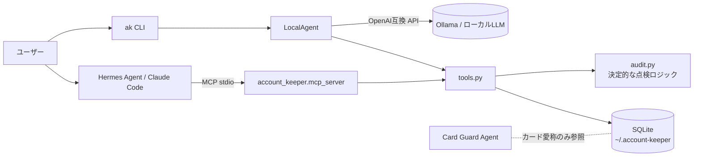

# Account Keeper Agent 🗝️

> **Status: Mock / Planned** — 構想を動く形で示すためのモックです。

「どのWebサービスに、どのメール・電話・住所・2FAで登録したか」をローカルで管理し、
**引っ越し・メアド変更・電話番号変更・放置アカウント整理** を手伝うエージェント。

- 🏠 **ローカルファースト** — データは手元の SQLite のみ。推論もローカル LLM（Ollama）
- 🔌 **MCP サーバー** — Hermes Agent / Claude Code など任意の MCP クライアントから呼べる
- 🙅 **パスワードは持たない** — パスワードはパスワードマネージャー、カードは [Card Guard Agent](#関連プロダクト) の担当。
  `password` / `card_number` などの項目は保存時に拒否します

## できること（モック版）

| ツール | 内容 |
|---|---|
| `audit_2fa` | 2FA なし／SMS／メールのみのアカウントを、金融・行政・仕事系を優先して列挙 |
| `find_dormant` | 長期間使っていないアカウント（退会候補。カード登録が残っていれば強調） |
| `plan_change` | メール・電話・住所ラベル・カード愛称を変えるとき、更新が必要なサービスを重要度順に。SMS 2FA の罠も警告 |
| `email_exposure` | メールアドレスごとの紐づきサービス数（漏えい時の影響範囲） |
| `list_accounts` / `search_accounts` / `upsert_account` | 登録情報の参照・更新 |

## クイックスタート

依存パッケージなし（Python 3.10+ 標準ライブラリのみ）。

```bash
git clone https://github.com/johnknash2025/account-keeper-agent
cd account-keeper-agent
python -m account_keeper demo        # 架空のサンプル12件を読み込む
python -m account_keeper audit       # まとめて点検
python -m account_keeper change phone 090-0000-0001   # 電話番号変更の影響範囲
```

```text
■ 2FA が弱い
  [high  ] CloudConsole           email  → パスキーかTOTPに切り替え
  [high  ] MyBank Online          sms    → パスキーかTOTPに切り替え
  [medium] FurimaPlus             none   → 2FAを有効化
■ 休眠アカウント（12ヶ月以上）
  PhotoShare             1052日 → 退会を検討
  FurimaPlus             959日 → 退会 or 登録カード解除
```

## ローカル LLM エージェント（Ollama）

```bash
ollama pull qwen3:8b
export ACCOUNT_KEEPER_MODEL=qwen3:8b      # 任意のツール呼び出し対応モデル
python -m account_keeper ask -v "電話番号を変えるんだけど、何から手をつければいい？"

# LLM なしで動作確認するとき
python -m account_keeper ask --offline "放置してるアカウントある？"
```

OpenAI 互換 API なら何でも可（`ACCOUNT_KEEPER_LLM_URL`、既定 `http://localhost:11434/v1`）。
登録情報をクラウドに出さないため、既定ではローカル推論を想定しています。

## Hermes Agent / Claude Code から使う（MCP）

```bash
python -m account_keeper.mcp_server   # stdio で起動（依存ゼロの最小実装）
```

- Hermes Agent: [`examples/hermes-config.yaml`](examples/hermes-config.yaml)
- Claude Code: [`examples/claude-code.mcp.json`](examples/claude-code.mcp.json)

親エージェント（Hermes 等）から「引っ越しタスク」のサブタスクとして `plan_change(field="address_label", old_value="旧住所")` を呼ぶ、といった使い方を想定。

## アーキテクチャ



点検ロジックは LLM に依存しない決定的なコード（`audit.py`）に寄せ、LLM は「どのツールを呼ぶか」と「結果の説明・優先順位付け」だけを担当します。

## データモデル

| 項目 | 例 | 備考 |
|---|---|---|
| `service` | MegaMart | 主キー |
| `category` | shopping / sns / finance / gov / work / other | 重要度判定に使用 |
| `email`, `phone`, `login_id` | | |
| `address_label` | 自宅 / 旧住所 / 畑の倉庫 | **住所そのものではなくラベル** |
| `two_factor` | none / sms / email / totp / passkey | |
| `payment_ref` | メインカード | Card Guard 側のカード**愛称**のみ |
| `last_used` | 2026-10-10 | |

## ロードマップ

- [ ] DB の暗号化（SQLCipher or age）
- [ ] メール受信箱から「登録完了」メールを拾って自動登録（ローカル処理）
- [ ] 漏えい情報との突き合わせ（[leakwatch-jp](https://github.com/johnknash2025/leakwatch-jp) 連携）
- [ ] 退会手続きページへの案内・ブラウザ操作エージェント連携
- [ ] Card Guard Agent との連携（カード再発行時の更新対象洗い出し）

## 関連プロダクト

- **Card Guard Agent**（Planned）— カード管理エージェント。金融情報は意図的にこちらと分離しています。

## License

MIT
